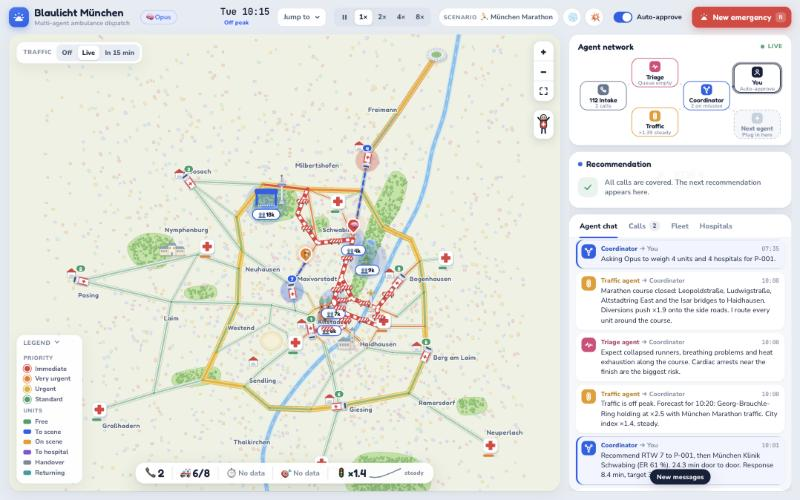

# Blaulicht München

An ambulance dispatch simulation for Munich in which three cooperating AI agents decide which ambulance goes to which patient, which way it drives and which hospital takes the patient.

Built at the Anthropic Partner Basecamp in Munich on 3 and 4 November 2026.



## What it does

Emergency calls arrive on a playful map of Munich, seen from above. For every call, the agents talk to each other in the agent chat and produce one recommendation: an ambulance, its route and a hospital. You approve it with one click, or let auto approve dispatch it after four seconds. Ambulances then drive with blinking blue lights, treat the patient on scene, drive to the hospital and return to their station.

You can add calls yourself. Drag the little patient from the dock on the map and drop it anywhere in the city, or pick a case from **New emergency**.

## The agents

| Agent | Job | Uses Claude |
|---|---|---|
| Triage agent | Ranks every call RED, ORANGE, YELLOW or GREEN from the caller's words, age and vitals, in the style of the Manchester Triage System. Waiting patients move up the queue as time passes. | Reviews each call and can change its colour, with a one sentence reason. |
| Traffic agent | Forecasts congestion on every road for the next 60 minutes from rush hour, scenarios, road closures, accidents and snow, and returns travel times for any route. | No, the forecast is computed. |
| Dispatch coordinator | Ranks the free ambulances and the hospitals that can treat the patient, recommends one of each, reroutes ambulances around accidents and diverts an ambulance from a lower priority call when a RED call has no free unit. | Chooses between the four best ambulances and hospitals and explains the choice on the recommendation card. |

The agents only talk through a shared message bus, which is what the agent chat shows. The dashed "Next agent" node in the agent network marks where another agent plugs in, for example one that tracks hospital capacity.

## Scenarios

| Scenario | Clock | People in crowds | Effect on the city |
|---|---|---|---|
| Normal day | Any time | None | Commuter peaks around 08:00 and 17:30 |
| München Marathon | 10:00 | 44,000 | 14 roads on the course closed, more collapsed runners and breathing problems |
| Christmas markets | 18:00 | 58,000 | Slow Altstadtring and Theresienwiese, more falls on icy cobblestones and intoxication |
| FC Bayern home game | 19:30 | 90,000 | A9 and the north of the city jammed around kick off |
| Oktoberfest | 21:00 | 128,000 | Gridlock around the Theresienwiese, a wave of intoxication calls |

Snowfall works on top of any scenario, and **Crash on the Ring** puts an accident on the Mittlerer Ring.

## Run it

The app runs with or without a Claude API key. The badge next to the title shows which mode is active: **Rules** or **Opus**.

### Without an API key

Nothing to install. Open `index.html` in a browser, or serve the folder with any static web server:

```bash
python3 -m http.server 8800
```

Then open http://127.0.0.1:8800. All three agents run on their built in rules, and every feature of the simulation works.

### With an API key

The triage agent and the dispatch coordinator then ask Claude. You need [uv](https://docs.astral.sh/uv/).

1. Create a file called `.env` next to `server.py`:

   ```
   ANTHROPIC_API_KEY=your-key
   ```

2. Start the server:

   ```bash
   uv run server.py
   ```

3. Open http://127.0.0.1:8800.

Optional settings in `.env`: `ANTHROPIC_MODEL` to use another model, for example `claude-haiku-5-5`, and `PORT` to change the port. `server.py` also runs without a key, in rules mode.

## How Claude is used

`server.py` calls `claude-opus-5-5` through the official Anthropic Python SDK with low effort, a JSON schema for the answer and the server side refusal fallback. Each decision takes about four seconds. When the model does not answer within 25 seconds or returns an error, the rules decide, so the simulation never stalls.

The API key stays on the server and never reaches the browser. The server only serves `index.html`, `js/` and `css/`, so `.env` and the server code cannot be downloaded.

The page finds out which mode to use from `js/config.js`. The file in the repository switches the model agents off. `server.py` answers the same path with a version that switches them on when a key is set, so the page never calls a model server that is not there.

## Controls

| Control | Action |
|---|---|
| Drag the patient from the map dock | Report an emergency where it lands |
| Space | Pause and resume |
| N | Open New emergency |
| Esc | Close a menu or cancel placing |
| Traffic: Live or In 15 min | Show the current traffic or the forecast |
| Hold on the recommendation card | Keep a call waiting for three minutes |

## Project structure

| Path | Contents |
|---|---|
| `server.py` | Serves the app and the triage and dispatch endpoints that call Claude |
| `js/data.js` | Munich road network, hospitals, ambulance stations and scenarios |
| `js/agents.js` | Routing and the triage, traffic and coordinator agents |
| `js/config.js` | Runtime mode, rules only unless `server.py` serves the page |
| `js/llm.js` | Browser client for the Claude endpoints |
| `js/sim.js` | Calls, ambulance missions, the clock and the scenarios |
| `js/map.js`, `js/drag.js` | The map, its animations and the draggable patient |
| `js/ui.js`, `index.html`, `css/` | Control room, recommendation card, agent chat and controls |
| `CONTRACT.md` | Interfaces between the modules |

The front end is plain JavaScript with no build step and no dependencies.

## Limits

This is a hackathon demo and not a dispatch system. The road network is simplified to 63 junctions and 90 roads. Hospital names are real, but their capabilities and emergency room loads are invented for the simulation. Do not use it for real emergencies.

## How it was built

The app was built in one afternoon with Claude Code. Four parallel subagents wrote the map, the agents, the simulation and the control room against a shared interface contract, and the lead session put the pieces together and tested them in the browser.
